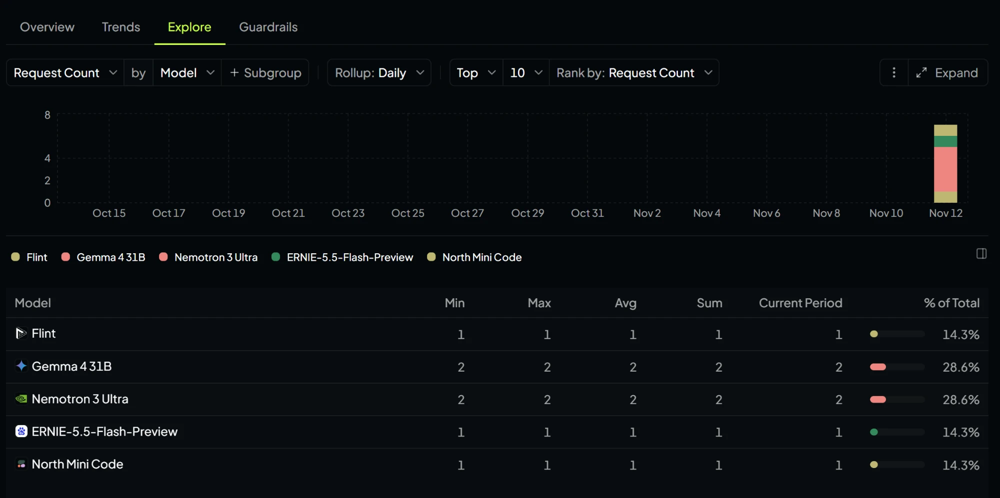

# ride-dispatch-langgraph

Python + LangGraph project that takes a week (3-9 March 2025) of ride requests and candidate-driver snapshots and ranks the best 3-4 drivers per request.

- `data/ride_requests.csv` – 20 ride requests
- `data/candidate_drivers.csv` – candidate drivers per request

## Graph

```
START -> filter_available -> rank_drivers -> END
```

1. `filter_available` – keeps only drivers with `driver_status == "available"`. `on_trip` and `offline` drivers are cut and never reach node 2 or the model.
2. `rank_drivers` – sends the ride request plus all available drivers to a free OpenRouter model (default `google/gemma-4-31b-it:free`, falls back to `openrouter/free`). The model ranks the top 3-4. The code validates the answer: unknown or duplicate driver IDs are dropped, and any gap is filled in road-minutes order. Arrival time is computed from the data (request time + that driver's `road_pickup_minutes`), never taken from the model.

`rider_id` is never sent to the model.

## Setup

```bash
pip install -r requirements.txt
cp .env.example .env   # then add your OPENROUTER_API_KEY
python -m src.ride_dispatch.graph RQ-0304-005
```

## Output

Run on `RQ-0304-005` (3 of 4 candidates available):


Full output is in [`docs/output.txt`](docs/output.txt).

## Prompt excerpt

From `_build_prompt` in [`src/ride_dispatch/graph.py`](src/ride_dispatch/graph.py):

```
Ride request context: {requested_at, pickup_zone, pickup_lat, pickup_lng, pickup_river_side,
                       dropoff_zone, is_bridge_case, distance_time_disagree}

Available candidate drivers: [{driver_id, straight_line_km, road_pickup_minutes,
                               driver_river_side, driver_lat, driver_lng,
                               status_updated_at, route_note}, ...]

Rank the top {n} drivers to offer this ride, best first. Prefer the lowest road_pickup_minutes
unless a route_note, the river side or the bridge context makes that time unreliable.
Only use driver_ids from the list above. Reply with JSON only:
{"ranking": [{"driver_id": "<id>", "reason": "<short>"}]}
```

The road-minutes rule matters because straight-line distance can mislead: in the example above, `DRV-26148` is physically closest (0.33 km) but needs 8 minutes by road because of a one-way loop, so it ranks below `DRV-47038` (0.67 km, 4 min).

## Failure handling

The graph does not crash on a bad model reply or an empty candidate list. Every result has a `status`:

| `status` | When | Result |
|---|---|---|
| `ranked` | Model returned enough valid, unique candidate IDs | The model's ranking (top 3-4) |
| `ranked_fallback` | Model returned null / "nobody", IDs not on the list, duplicates, malformed JSON, or the API failed | Valid picks kept in the model's order, remaining slots filled by fastest `road_pickup_minutes` |
| `pending_approval` | No candidate is `available` | `"message": "Pending approval"`, empty `ranking`; the model is not called |

## Plan-mode prompt

I designed this with two prompts in plan mode, quoted as I wrote them.

First (two-node graph):

> "Can you make a two-node graph? And I want like the nodes to kind of be like the first one receives available drivers, so it only takes in people who have the available tag. On trip and offline don't come through. And then the second node is going to take in their other data, like how far away they are from the trip, etc., like all that."

Second (the ranking design this repo implements):

> "Okay, so basically, like, ignore like my last message. What I want you to do is like the code needs to do, like the first node, and I think it's LangGraph, needs to just scan for available drivers, and then it cuts out all the unavailable ones or offline ones for the next stage, into the second node. We have all the available drivers. This is then sent with the user and all the drivers to the open router key, the open router then bases its top three or four rankings so just create a plan to implement this, and let me know."

## Pushback

I read the plan and asked what happens if no drivers are available, since it would crash. My exact question:

> "But if it were to return like nobody, or it starts returning people that aren't on the list, what are you going to return to the user? And what are you going to output?"

The plan had no branch for zero candidates: if every driver was `on_trip` or `offline`, nothing reached the model node and it crashed. My question is what led to adding one.

**What the user gets back:**

| Situation | What comes back |
|---|---|
| No available drivers for the request | `status: "pending_approval"`, `message: "Pending approval"`, empty `ranking`. The model is never called. |
| Model names nobody, or a driver not on the list | `status: "ranked_fallback"`: the valid picks, topped up in road-minutes order. Always real, available drivers. |
| Normal case | `status: "ranked"`: the model's top 3-4 with arrival times computed from the data. |

```json
{
  "request_id": "RQ-0304-005",
  "status": "pending_approval",
  "message": "Pending approval",
  "ranking": []
}
```

## OpenRouter usage

Activity from the OpenRouter dashboard (Explore tab, Request Count by Model, daily rollup) showing the graph is calling the free models. On 12 Nov it logged 7 requests across 5 free models (Gemma 4 31B 2, Nemotron 3 Ultra 2, Flint 1, ERNIE-5.5-Flash-Preview 1, North Mini Code 1); the `openrouter/free` fallback routes between free models, which is why more than one appears.


