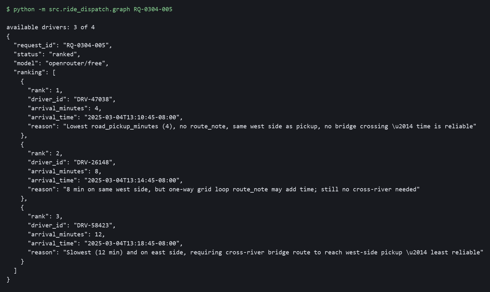
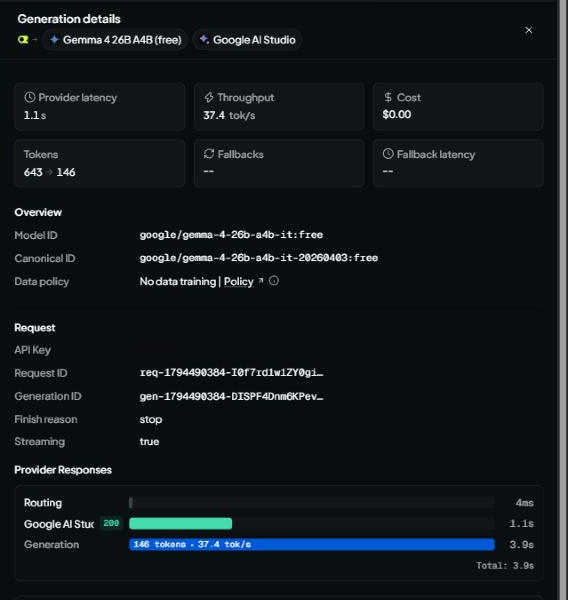
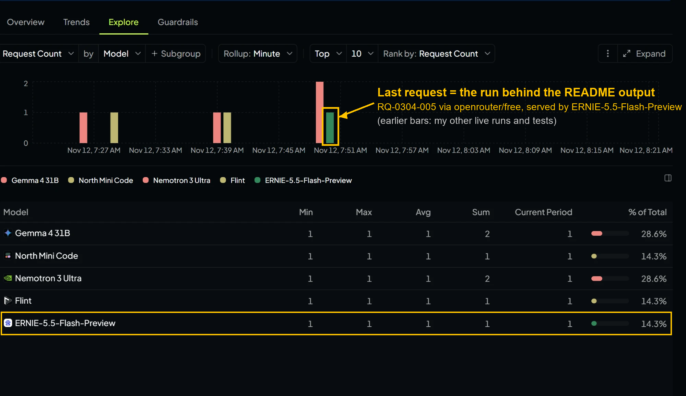

# ride-dispatch-langgraph

Python + LangGraph project that takes a week (3-9 March 2025) of ride requests and candidate-driver snapshots and ranks the best 3-4 drivers per request.

- `data/ride_requests.csv` – 20 ride requests
- `data/candidate_drivers.csv` – candidate drivers per request

## Graph

```
START -> availability -> pickup_minutes -> eligibility -> rank_drivers -> END
```

1. `availability` – keeps only drivers with `driver_status == "available"`. `on_trip` and `offline` drivers are cut and never reach the later nodes or the model.
2. `pickup_minutes` – drops drivers with no `road_pickup_minutes`, then keeps only the fastest 4 per request (`MAX_CANDIDATES`).
3. `eligibility` – keeps drivers whose `status_updated_at` is at most 120 minutes (`MAX_STATUS_AGE_MIN`) before the request time. A status stamped after the request time counts as fresh; an unreadable timestamp counts as not fresh.
4. `rank_drivers` – sends the ride request plus all available drivers to a free OpenRouter model (default `google/gemma-4-31b-it:free`, falls back to `openrouter/free`). The model ranks the top 3-4. The code validates the answer: unknown or duplicate driver IDs are dropped, and any gap is filled in road-minutes order. Arrival time is computed from the data (request time + that driver's `road_pickup_minutes`), never taken from the model.

`rider_id` is never sent to the model.

## Setup

```bash
pip install -r requirements.txt
cp .env.example .env   # then add your OPENROUTER_API_KEY
python -m src.ride_dispatch.graph RQ-0304-005
```

## Checking the run order

All three checks run before the model, in this order: `availability`, `pickup_minutes`, `eligibility`, then `rank_drivers`, which makes the one model call. Each node adds its name to a `steps` list in the state, and the command line prints it:

```
steps run, in order: availability -> pickup_minutes -> eligibility -> rank_drivers
drivers: 4 candidates -> 3 available -> 3 after pickup_minutes -> 3 eligible
```

The tests in [`tests/test_graph_order.py`](tests/test_graph_order.py) check the order three ways: they wrap each node and the model call to log when they start, compare the `steps` list, and compare the order LangGraph itself reports. They also check that the model is never called when no driver survives. They use a fake model reply, so no API key is needed:

```bash
python -m unittest tests.test_graph_order -v
```

Because each node reads the previous node's output, running them out of order fails with a `KeyError` instead of silently giving a different answer.

## Output

The output below was produced before the three checks were added. `RQ-0304-005` passes all of them unchanged (3 drivers in, 3 out), so its ranking is the same. Run on `RQ-0304-005` (3 of 4 candidates available):



Full output is in [`docs/output.txt`](docs/output.txt).

### OpenRouter's record of this run

The output carries OpenRouter's own IDs for the call, captured from the API response in the same run that produced the `RQ-0304-005` ranking:

```
"generation_id": "gen-1794490384-DISPF4Dnm6KPevQEf61k"
"served_model":  "google/gemma-4-26b-a4b-it:free"      (requested: openrouter/free)
```

I then looked that ID up with OpenRouter's generation API (`python scripts/lookup_generation.py <generation_id>`). The single record, saved in [`docs/openrouter-record.json`](docs/openrouter-record.json) with account identifiers removed, says:

| Field | Value |
|---|---|
| Generation ID | `gen-1794490384-DISPF4Dnm6KPevQEf61k` |
| Request ID | `req-1794490384-I0f7rd1w1ZY0giEMPlsO` |
| Time | 2026-11-12 13:33:04 UTC |
| Requested model | `openrouter/free` (router) |
| Model that served it | `google/gemma-4-26b-a4b-it-20260403:free` |
| Provider | Google AI Studio, status 200 |
| Tokens | 643 prompt, 146 completion (native, as the provider counts them); 375 / 109 in OpenRouter's normalized count |
| Finish reason / cost | `stop` / $0 |

The record has no prompt text and no `RQ-0304-005` ID, because OpenRouter never sees my request IDs. The link is the generation ID: the graph printed it in the output for `RQ-0304-005`, and the record above is what OpenRouter holds for that ID.

### The same call on OpenRouter's Activity page

I also opened this request on the OpenRouter Activity page (Logs > Generations, times shown in EST) and copied its row and its Generation details as text. The API Key column, which is just my key's label, is left out.

```
Date:        Nov 12, 08:33 AM
Model:       Gemma 4 26B A4B (free)
Provider:    Google AI Studio
Cost:        $0.00
Input:       643 tok
Output:      146 tok
Usage type:  Credits
Speed:       37.4 tok/s
Routing overhead: 0 s
Time to first token: 1.11 s
Finish reason: stop

Generation details
Model ID:     google/gemma-4-26b-a4b-it:free
Canonical ID: google/gemma-4-26b-a4b-it-20260403:free
Request ID:   req-1794490384-I0f7rd1w1ZY0giEMPlsO
Generation ID: gen-1794490384-DISPF4Dnm6KPevQEf61k
Streaming:    true
Provider response: Google AI Studio, 200, 1.1 s
Total: 3.9 s
```

Screenshot of that row's Generation details (the page truncates the two IDs on screen; the full values are in the text above). I covered only the label of my API key:



Two things in this row look odd at first, so here is what I know:

- **Tokens, 643 vs 375.** The record has two sets of counts. The Activity page shows the provider's native counts (643 in, 146 out), which are the `native_tokens_*` fields in the API record. The `tokens_prompt` / `tokens_completion` fields (375 / 109) are OpenRouter's normalized counts of the same call. Both are in [`docs/openrouter-record.json`](docs/openrouter-record.json).
- **Streaming: true.** My code never sets a streaming option (there is no `stream` anywhere in `src/`), yet both the API record (`streamed: true`) and this page report it. I have not found out why. I only know it is what OpenRouter reports for this call, and it doesn't change the ranking, which the graph read from a normal non-streamed response.

The Request ID and Generation ID are identical to the ones the graph printed and to the API record above, and the model that served it is Gemma 4 26B A4B. The Activity page says "I/O logging is not enabled" for my account, so it shows no prompt or completion text. Because of that, the prompt cannot be checked against this row; the ID is the link.

## Prompt excerpt

From `_build_prompt` in [`src/ride_dispatch/graph.py`](src/ride_dispatch/graph.py):

```
Ride request context: {requested_at, pickup_zone, pickup_lat, pickup_lng, pickup_river_side,
                       dropoff_zone, is_bridge_case, distance_time_disagree}

Available candidate drivers: [{driver_id, straight_line_km, road_pickup_minutes,
                               driver_river_side, driver_lat, driver_lng,
                               status_updated_at, route_note}, ...]

Rank the top {n} drivers to offer this ride, best first. Prefer the lowest road_pickup_minutes
unless a route_note, the river side or the bridge context makes that time unreliable.
Only use driver_ids from the list above. Reply with JSON only:
{"ranking": [{"driver_id": "<id>", "reason": "<short>"}]}
```

The road-minutes rule matters because straight-line distance can mislead: in the example above, `DRV-26148` is physically closest (0.33 km) but needs 8 minutes by road because of a one-way loop, so it ranks below `DRV-47038` (0.67 km, 4 min).

## Failure handling

The graph does not crash on a bad model reply or an empty candidate list. Every result has a `status`:

| `status` | When | Result |
|---|---|---|
| `ranked` | Model returned enough valid, unique candidate IDs | The model's ranking (top 3-4) |
| `ranked_fallback` | Model returned null / "nobody", IDs not on the list, duplicates, malformed JSON, or the API failed | Valid picks kept in the model's order, remaining slots filled by fastest `road_pickup_minutes` |
| `pending_approval` | No driver is left after `availability`, `pickup_minutes` and `eligibility` | `"message": "Pending approval"`, empty `ranking`; the model is not called |

## Plan-mode prompt

I designed this with two prompts in plan mode (tidied up here, with filler words removed).

First (two-node graph):

> "Can you make a two-node graph? The first node receives available drivers, so it only takes in drivers with the available tag. On-trip and offline drivers don't come through. The second node takes in their other data, like how far away they are from the trip."

Second (the ranking design this repo implements):

> "Ignore my last message. Instead, I want the code to work like this: the first node, in LangGraph, scans for available drivers and cuts out the unavailable and offline ones before the second node. The second node then has all the available drivers. These are sent, along with the ride request, to OpenRouter, which ranks the top three or four. Create a plan to implement this and let me know."

## Pushback

I read the plan and asked what happens if no drivers are available, since it would crash. I looked through Claude Code's plan, saw that it didn't cover what happens when there are zero available drivers, and flagged it myself with this question to get it fixed. My question, tidied up:

> "What happens if the model returns nobody, or starts returning drivers that aren't on the list? What are you going to return to the user, and what are you going to output?"

The plan had no branch for zero candidates: if every driver was `on_trip` or `offline`, nothing reached the model node and it crashed. My question is what led to adding one.

**What the user gets back:**

| Situation | What comes back |
|---|---|
| No available drivers for the request | `status: "pending_approval"`, `message: "Pending approval"`, empty `ranking`. The model is never called. |
| Model names nobody, or a driver not on the list | `status: "ranked_fallback"`: the valid picks, topped up in road-minutes order. Always real, available drivers. |
| Normal case | `status: "ranked"`: the model's top 3-4 with arrival times computed from the data. |

```json
{
  "request_id": "RQ-0304-005",
  "status": "pending_approval",
  "message": "Pending approval",
  "ranking": []
}
```

## OpenRouter usage

Activity from my OpenRouter dashboard (Explore tab, Request Count by Model, minute rollup) showing the graph is calling the free models. On 12 Nov it logged 7 requests across 5 free models (Gemma 4 31B 2, Nemotron 3 Ultra 2, Flint 1, ERNIE-5.5-Flash-Preview 1, North Mini Code 1); the `openrouter/free` fallback routes between free models, which is why more than one appears.

This screenshot is general usage from my earlier live runs and tests, taken before the run shown in the Output section. It does not identify any single request. The record for the `RQ-0304-005` output run is the ID lookup above, not a bar in this chart.


